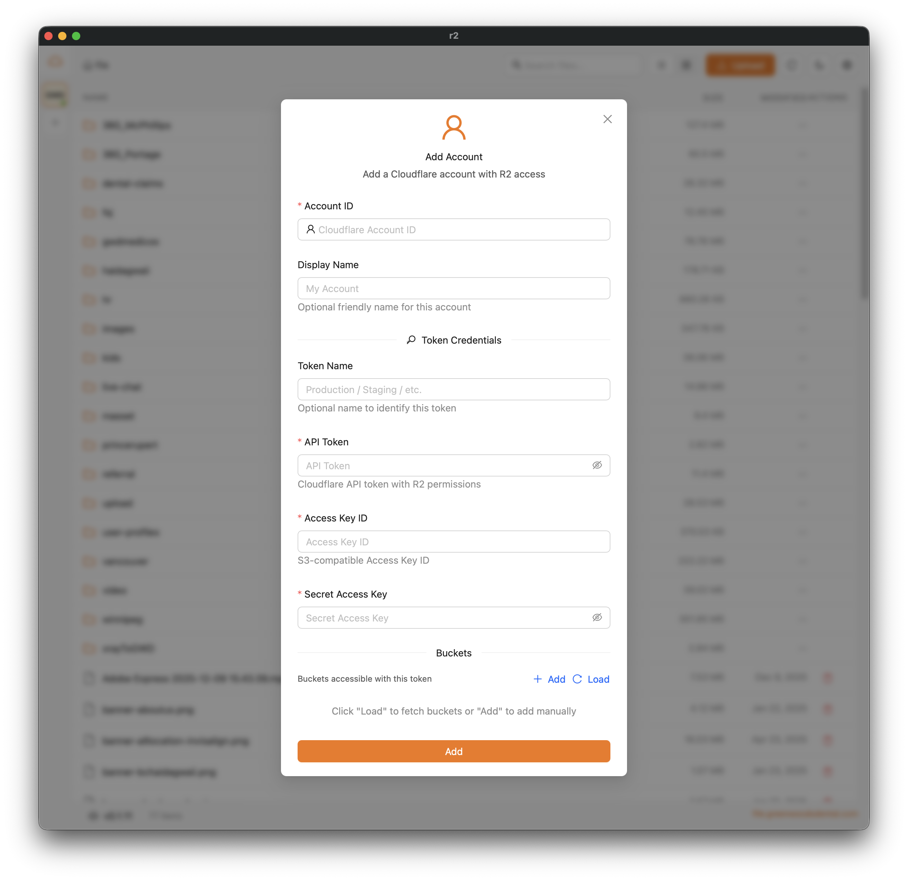

[English](./README.md) | [简体中文](./README.zh-CN.md) | [हिन्दी](./README.hi.md) | **Español** | [日本語](./README.ja.md)

# Cloudflare R2 Client — Cliente gráfico S3 de escritorio, gratuito y de código abierto, para macOS, Windows y Linux

**Cloudflare R2 Client** es una aplicación de escritorio (GUI) gratuita y de código abierto para gestionar almacenamiento de objetos **Cloudflare R2**, **AWS S3**, **MinIO** y **RustFS** desde tu Mac, PC con Windows o equipo Linux. Explora buckets, sube y descarga archivos con transferencias multiparte reanudables, previsualiza imágenes, vídeos, PDF y código, gestiona varias cuentas y tokens, y mueve archivos entre proveedores, todo desde una aplicación nativa y rápida creada con **Tauri**, **Next.js** y **React**.

> ¿Buscas una GUI gratuita para Cloudflare R2, un cliente S3 para Mac, un navegador de escritorio para MinIO o un gestor de archivos para RustFS? Este es el cliente de almacenamiento compatible con S3, todo en uno, que estabas buscando.

**Palabras clave:** cliente de escritorio Cloudflare R2, GUI de R2, cliente S3 para macOS, GUI de S3 para Windows, navegador MinIO, GUI de RustFS, gestor de archivos S3, aplicación de escritorio de almacenamiento de objetos, cargador R2 con Tauri.

## Características

- **Soporte multiproveedor** - R2, AWS S3, MinIO y RustFS (estilo de ruta forzado)
- **Soporte multicuenta** - Gestiona varias cuentas de distintos proveedores
- **Varios tokens por cuenta (R2)** - Cada cuenta puede tener varios tokens de API con acceso a distintos buckets
- Explora y gestiona archivos en buckets compatibles con S3
- Sube archivos y carpetas con cargas multiparte reanudables
- **Vista previa de archivos** - Previsualiza archivos directamente en la aplicación:
  - **Imágenes**: jpg, jpeg, png, gif, webp, svg, bmp, ico
  - **Vídeos**: mp4, webm, ogg, mov, m4v
  - **PDF**: visor de PDF completo con navegación por páginas
  - **Texto/Código**: visor con resaltado de sintaxis basado en Monaco Editor, compatible con:
    - Código: js, ts, jsx, tsx, css, scss, less, html, vue, svelte
    - Configuración: json, yaml, yml, toml, xml, ini, env
    - Documentos: txt, md, markdown, rst, log
    - Scripts: sh, bash, zsh, fish, ps1, bat, cmd
    - Datos: csv, sql
- **Operaciones por lotes** - Selecciona varios archivos y carpetas para:
  - **Descarga por lotes** - Descarga varios archivos con seguimiento del progreso y opción de pausar/reanudar
  - **Movimiento por lotes** - Mueve archivos a otras carpetas con un selector de árbol de carpetas
  - **Eliminación por lotes** - Elimina varios archivos con confirmación e indicador de progreso
  - **Cambio de nombre por lotes en una carpeta** - Renombra los archivos de una carpeta con confirmación e indicador de progreso
- **Transferencia entre cuentas** - Transferencia de archivos de alto rendimiento entre distintas cuentas/proveedores:
  - Transfiere archivos entre R2, AWS S3, MinIO y RustFS
  - Copia del lado del servidor cuando es posible (mismo proveedor)
  - Transferencia en streaming sin archivos temporales entre proveedores distintos
  - Cargas multiparte en paralelo para archivos grandes (4 partes simultáneas)
  - Hasta 5 transferencias simultáneas
  - Seguimiento del progreso en tiempo real con indicación de velocidad
  - Pausar/reanudar/cancelar transferencias individuales o todas a la vez
  - Procesamiento en segundo plano: la cola continúa aunque cierres el modal
  - La cola continúa automáticamente al terminar cada transferencia
- **Montar como unidad local** - Monta cualquier bucket en una carpeta local y trabaja con él en Finder / el Explorador:
  - Lectura y escritura por defecto: guarda, renombra y elimina archivos directamente en la carpeta; un interruptor por montaje lo deja en solo lectura
  - Montaje NFS servido por la propia aplicación: sin macFUSE, WinFsp ni extensiones del kernel
  - Gestiona todos los montajes activos desde Ajustes → Montajes
  - Funciona con todos los proveedores (R2, AWS S3, MinIO, RustFS)
  - En macOS se monta al instante sin software adicional; Linux necesita nfs-utils; el soporte para Windows está previsto
  - Todos los montajes se eliminan automáticamente al cerrar la aplicación
- Generación de miniaturas de vídeo (ffmpeg viene incluido en la aplicación; no hace falta instalarlo aparte)
- Copia URL firmadas o públicas al portapapeles (enlaces generados según el proveedor)
- Modo oscuro
- Actualizaciones automáticas
- «Informar de un problema» con un clic, que abre un borrador de issue de GitHub ya rellenado con la versión de la aplicación, el sistema operativo y los errores de la aplicación de los últimos 5 minutos (las claves de acceso y los secretos se ocultan; tú lo revisas y no se envía nada hasta que pulsas Submit)

## Instalación

### Homebrew (macOS)

```bash
brew install dickwu/tap/r2
```

### Descarga

Descarga la última versión para tu plataforma desde la [página de Releases](https://github.com/dickwu/r2/releases/latest):

- macOS: .dmg (Apple Silicon e Intel)
- Windows: instalador .msi o .exe
- Linux: .deb, .rpm o .AppImage

## Capturas de pantalla



### Requisitos

- [Node.js](https://nodejs.org/) (v18+)
- [Bun](https://bun.sh/) - Gestor de paquetes
- [Rust](https://www.rust-lang.org/tools/install) - Para el backend de Tauri

### Miniaturas de vídeo

No necesitas configurar nada: la aplicación incluye su propio ffmpeg para generar miniaturas de vídeo, así que no tienes que instalar ffmpeg en tu sistema.

## Instalación en macOS

En macOS tienes que permitir manualmente que la aplicación se ejecute:

1. Abre Ajustes del Sistema → Privacidad y seguridad
2. Haz clic en «Abrir igualmente» junto al mensaje de aplicación bloqueada

Si la aplicación no aparece en Privacidad y seguridad, ejecuta:

```bash
sudo xattr -d com.apple.quarantine /Applications/r2.app/
```

Si aparece un error que impide ejecutarla, prueba a ejecutar:

```bash
rm -rf ~/Library/Application\ Support/com.lifefarmer.r2/
rm -rf ~/Library/Caches/com.lifefarmer.r2/
rm -rf ~/Library/Saved\ Application\ State/com.lifefarmer.r2.savedState/
```

## Desarrollo

```bash
# Instalar dependencias
bun install

# Iniciar el servidor de desarrollo
bun run tauri dev
```

### Depuración con tauri-connector

[tauri-connector](https://github.com/dickwu/tauri-connector) está integrado para la depuración y las pruebas asistidas por IA. Ofrece inspección del DOM, interacción con elementos, capturas de pantalla y acceso a los registros de la consola mediante CLI o servidor MCP.

```bash
# Iniciar con el conector activado (puertos fijos: WS 9568, MCP 9567 — ver .mcp.json)
bun run tauri:dev

# Comandos de la CLI (con la aplicación en ejecución)
tauri-connector snapshot -i          # Instantánea del DOM para IA con referencias a elementos
tauri-connector click @e5            # Hacer clic en un elemento por referencia
tauri-connector fill @e18 "query"    # Rellenar el cuadro de búsqueda
tauri-connector screenshot /tmp/r2.png  # Hacer una captura de pantalla
tauri-connector logs -n 20           # Ver los registros de la consola
```

Instala la CLI: `cargo install connector-cli`

## Compilación

```bash
# Compilar para producción
bun run tauri build
```

### Compilación cruzada para Windows (desde macOS/Linux)

Para compilar binarios de Windows desde macOS o Linux necesitas herramientas adicionales:

```bash
# Instalar las dependencias necesarias
# macOS
brew install cmake ninja llvm nsis

# Ubuntu/Debian
sudo apt-get install cmake ninja-build llvm nsis

# Instalar cargo-xwin
cargo install --locked cargo-xwin

# Configurar la toolchain de Windows
cargo xwin setup

# Añadir el target de Windows
rustup target add x86_64-pc-windows-msvc

# Compilar para Windows
bun run tauri build --runner cargo-xwin --target x86_64-pc-windows-msvc
```

Nota: la compilación cruzada es experimental. Para compilaciones de producción, considera usar GitHub Actions o una máquina virtual con Windows.

## Configuración

### Añadir una cuenta

1. En el primer inicio, el cuadro de diálogo «Add Account» (Añadir cuenta) se abre automáticamente
2. Elige el proveedor (R2, AWS, MinIO, RustFS) con las etiquetas seleccionables
3. Introduce las credenciales del proveedor:
   - R2:
     - Account ID (obligatorio) - ID de la cuenta de Cloudflare (de la URL del panel)
     - Token Name (opcional)
     - API Token - token de lectura/escritura de R2
     - Access Key ID / Secret Access Key
   - AWS S3:
     - Access Key ID / Secret Access Key
     - Region (obligatorio)
     - Endpoint (opcional, esquema + host personalizados)
     - Force Path Style (opcional)
   - MinIO:
     - Access Key ID / Secret Access Key
     - Endpoint (esquema + host/puerto)
     - Force Path Style (opcional)
   - RustFS:
     - Access Key ID / Secret Access Key
     - Endpoint (esquema + host/puerto)
     - Force Path Style siempre está activado (no configurable)
4. Haz clic en «Load» para obtener los buckets disponibles o añade los nombres de los buckets manualmente
5. Configura un dominio público para cada bucket (opcional, solo R2/AWS)

Consejos sobre endpoint y dominio

- Los campos de endpoint y dominio aceptan URL completas (esquema + host) y se normalizan automáticamente.
- Para los dominios públicos de R2/AWS puedes elegir http/https explícitamente.

### Gestionar varias cuentas

- Barra lateral - Muestra todas las cuentas configuradas con el número de tokens/buckets
- Clic en una cuenta - Abre un panel con todos los tokens y buckets de esa cuenta
- Clic en un bucket - Cambia a ese bucket
- Menú contextual - Edita o elimina cuentas/tokens
- Contraer la barra lateral - Haz clic en el icono de contraer para reducirla a una vista solo de iconos

### Sincronizar con otra cuenta (mover/copiar)

Usa el flujo de movimiento por lotes para sincronizar archivos entre cuentas/proveedores:

1. Añade la cuenta de origen y la de destino.
2. Cambia al bucket de origen en la barra lateral.
3. Selecciona archivos/carpetas -> Movimiento por lotes.
4. Elige la cuenta + bucket de destino y, opcionalmente, una carpeta de destino.
5. Activa o desactiva «Delete original» (eliminar original):
   - Activado = mover (los archivos de origen se eliminan tras la transferencia)
   - Desactivado = copiar (los archivos de origen se conservan)
6. Inicia la transferencia y sigue el progreso en el modal de movimiento o en la barra de estado.

Las transferencias se ponen en cola (hasta 5 simultáneas) y las del mismo proveedor usan preferentemente la copia del lado del servidor.

### Montar un bucket como unidad local

Monta cualquier bucket en una carpeta local y úsalo como un disco normal:

1. Abre el menú del bucket en la barra lateral (⋯) → Mount as local drive (Montar como unidad local).
2. Elige una carpeta local (por defecto `~/CloudMounts/<bucket>`). Los montajes admiten escritura por defecto; desactiva «Allow changes» (Permitir cambios) para un montaje de solo lectura.
3. Usa la carpeta en Finder / tu gestor de archivos: abre, copia, guarda, renombra y elimina archivos. Los cambios se suben al bucket en segundo plano poco después de terminar de escribir.
4. Gestiona los montajes activos en Ajustes → Montajes (mostrar, desmontar) o desde el menú del bucket. Todos los montajes se eliminan al cerrar la aplicación.

Cómo funciona: la aplicación ejecuta un pequeño servidor NFSv3 en `127.0.0.1` y lo monta con el cliente NFS integrado en tu sistema operativo; no requiere macFUSE, WinFsp ni extensiones del kernel. Renombrar o mover archivos dentro de un montaje se hace del lado del servidor en el bucket (sin volver a subirlos), igual que el movimiento propio de la aplicación. Nota: como cualquier montaje local, mientras un bucket está montado, otras aplicaciones de tu equipo pueden leer sus archivos y, en montajes con escritura, modificarlos; el servidor nunca es accesible desde la red.

Conviene saber sobre los montajes con escritura:

- Las subidas terminan en segundo plano: mantén la aplicación abierta hasta que acaben. Al desmontar se esperan las subidas pendientes; si cierras la aplicación durante una subida, el archivo no enviado se conserva en la carpeta de caché de la aplicación y su ubicación queda registrada en el log.
- Las eliminaciones y sobrescrituras en la carpeta son operaciones reales sobre el bucket.
- macOS escribe sus habituales archivos auxiliares `.DS_Store` y `._*` en la carpeta, así que también acaban en el bucket.
- Mover archivos entre dos buckets montados hace pasar los datos por tu equipo (una limitación de NFSv3); para transferencias grandes entre buckets, el movimiento por lotes de la aplicación es mucho más rápido porque copia del lado del servidor.

Notas por plataforma:

- macOS - Se monta al instante; sin software adicional ni sudo.
- Linux - Requiere `nfs-utils` (o `nfs-common`). Si tu distribución necesita root para montajes NFS, la aplicación muestra el comando `sudo mount` exacto que debes ejecutar una vez en un terminal.
- Windows - Aún no es compatible; está previsto para una versión futura.

### Obtener credenciales de API

Cloudflare R2

1. Ve al [Cloudflare Dashboard](https://dash.cloudflare.com/)
2. Navega a R2 → Overview → Manage R2 API Tokens
3. Crea un token con los permisos adecuados
4. Anota el Access Key ID y el Secret Access Key (solo se muestran una vez)

AWS S3

- Crea un usuario de IAM con permisos de S3 y genera claves de acceso.
- Anota la Region de tus buckets.

MinIO / RustFS

- Usa las claves de acceso/secretas de tu despliegue.
- Configura el host/puerto y el esquema (http/https) del endpoint.

## Almacenamiento de datos

La configuración de las cuentas se guarda localmente en una base de datos SQLite:

- macOS: `~/Library/Application Support/r2/uploads-turso.db`
- Windows: `%APPDATA%\r2\uploads-turso.db`
- Linux: `~/.local/share/r2/uploads-turso.db`

## Stack tecnológico

- **Frontend**: Next.js, React, Ant Design, Zustand
- **Backend**: Tauri (Rust)
- **Almacenamiento**: Cloudflare R2, AWS S3, MinIO, RustFS (compatibles con S3)
- **Base de datos**: SQLite (mediante Turso, una base de datos compatible con SQLite escrita en Rust)
- **Estado**: TanStack Query, Zustand

## Configuración del IDE

- [VS Code](https://code.visualstudio.com/) + [Tauri](https://marketplace.visualstudio.com/items?itemName=tauri-apps.tauri-vscode) + [rust-analyzer](https://marketplace.visualstudio.com/items?itemName=rust-lang.rust-analyzer)
