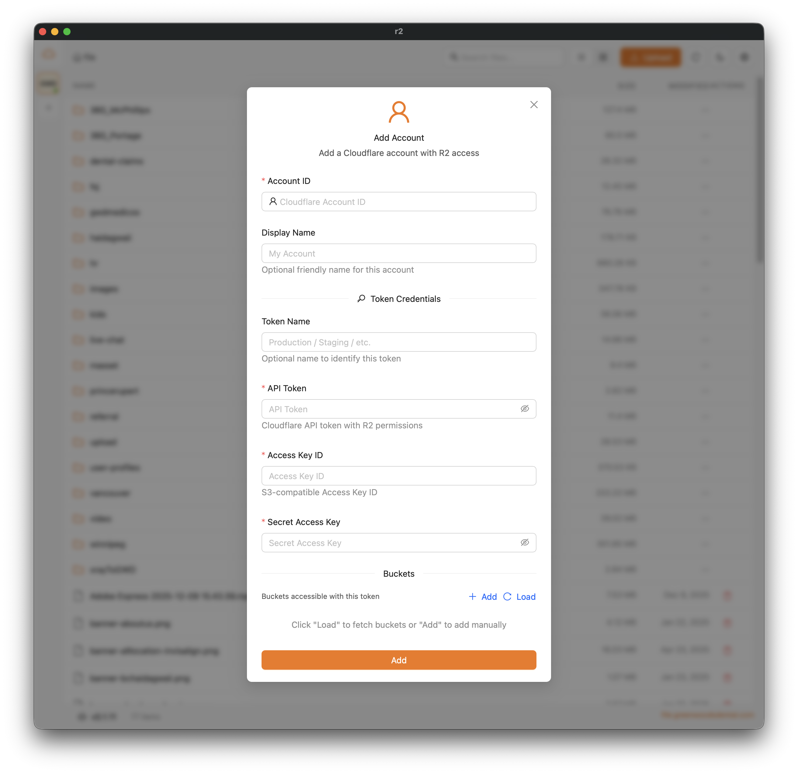

[English](./README.md) | [简体中文](./README.zh-CN.md) | **हिन्दी** | [Español](./README.es.md) | [日本語](./README.ja.md)

# Cloudflare R2 Client — macOS, Windows और Linux के लिए मुफ़्त, ओपन-सोर्स S3 डेस्कटॉप GUI

**Cloudflare R2 Client** एक मुफ़्त, ओपन-सोर्स डेस्कटॉप ऐप (GUI) है, जिससे आप अपने Mac, Windows PC या Linux मशीन से **Cloudflare R2**, **AWS S3**, **MinIO** और **RustFS** ऑब्जेक्ट स्टोरेज को प्रबंधित कर सकते हैं। बकेट ब्राउज़ करें, फिर से शुरू की जा सकने वाली मल्टीपार्ट ट्रांसफ़र के साथ फ़ाइलें अपलोड और डाउनलोड करें, इमेज / वीडियो / PDF / कोड का प्रीव्यू देखें, कई अकाउंट और टोकन प्रबंधित करें, और प्रोवाइडरों के बीच फ़ाइलें ले जाएँ — यह सब **Tauri**, **Next.js** और **React** से बने एक तेज़ नेटिव ऐप में।

> क्या आप मुफ़्त Cloudflare R2 GUI, Mac के लिए S3 क्लाइंट, MinIO डेस्कटॉप ब्राउज़र या RustFS फ़ाइल मैनेजर ढूँढ रहे हैं? यही वह ऑल-इन-वन S3-संगत स्टोरेज क्लाइंट है जिसकी आपको तलाश थी।

**कीवर्ड:** Cloudflare R2 डेस्कटॉप क्लाइंट, R2 GUI, S3 क्लाइंट macOS, S3 GUI Windows, MinIO ब्राउज़र, RustFS GUI, S3 फ़ाइल मैनेजर, ऑब्जेक्ट स्टोरेज डेस्कटॉप ऐप, Tauri R2 अपलोडर।

## सुविधाएँ

- **कई प्रोवाइडरों का समर्थन** - R2, AWS S3, MinIO और RustFS (पाथ-स्टाइल अनिवार्य)
- **कई अकाउंट का समर्थन** - अलग-अलग प्रोवाइडरों के कई अकाउंट प्रबंधित करें
- **प्रति अकाउंट कई टोकन (R2)** - हर अकाउंट में अलग-अलग बकेट एक्सेस वाले कई API टोकन हो सकते हैं
- S3-संगत बकेट में फ़ाइलें ब्राउज़ और प्रबंधित करें
- फिर से शुरू किए जा सकने वाले मल्टीपार्ट अपलोड के साथ फ़ाइलें और फ़ोल्डर अपलोड करें
- **फ़ाइल प्रीव्यू** - फ़ाइलों का प्रीव्यू सीधे ऐप में देखें:
  - **इमेज**: jpg, jpeg, png, gif, webp, svg, bmp, ico
  - **वीडियो**: mp4, webm, ogg, mov, m4v
  - **PDF**: पेज नेविगेशन के साथ पूरा PDF व्यूअर
  - **टेक्स्ट/कोड**: Monaco Editor पर आधारित सिंटैक्स-हाइलाइटेड व्यूअर, जो इनका समर्थन करता है:
    - कोड: js, ts, jsx, tsx, css, scss, less, html, vue, svelte
    - कॉन्फ़िग: json, yaml, yml, toml, xml, ini, env
    - दस्तावेज़: txt, md, markdown, rst, log
    - स्क्रिप्ट: sh, bash, zsh, fish, ps1, bat, cmd
    - डेटा: csv, sql
- **बैच ऑपरेशन** - कई फ़ाइलें और फ़ोल्डर चुनकर:
  - **बैच डाउनलोड** - प्रगति ट्रैकिंग और रोकें/फिर से शुरू करें के साथ कई फ़ाइलें डाउनलोड करें
  - **बैच मूव** - फ़ोल्डर ट्री पिकर से फ़ाइलों को दूसरे फ़ोल्डरों में ले जाएँ
  - **बैच डिलीट** - पुष्टि और प्रगति संकेतक के साथ कई फ़ाइलें हटाएँ
  - **फ़ोल्डर की फ़ाइलों का बैच रीनेम** - पुष्टि और प्रगति संकेतक के साथ किसी फ़ोल्डर की फ़ाइलों का नाम बदलें
- **क्रॉस-अकाउंट ट्रांसफ़र** - अलग-अलग अकाउंट/प्रोवाइडरों के बीच उच्च-प्रदर्शन फ़ाइल ट्रांसफ़र:
  - R2, AWS S3, MinIO और RustFS के बीच फ़ाइलें ट्रांसफ़र करें
  - जहाँ संभव हो, सर्वर-साइड कॉपी (एक ही प्रोवाइडर)
  - अलग-अलग प्रोवाइडरों के बीच बिना अस्थायी फ़ाइलों के स्ट्रीमिंग ट्रांसफ़र
  - बड़ी फ़ाइलों के लिए समानांतर मल्टीपार्ट अपलोड (4 पार्ट एक साथ)
  - एक साथ अधिकतम 5 ट्रांसफ़र
  - गति के साथ रीयल-टाइम प्रगति ट्रैकिंग
  - किसी एक या सभी ट्रांसफ़र को रोकें/फिर से शुरू करें/रद्द करें
  - बैकग्राउंड प्रोसेसिंग - मोडल बंद करने पर भी क़तार चलती रहती है
  - हर ट्रांसफ़र पूरा होने के बाद क़तार अपने आप आगे बढ़ती है
- **लोकल ड्राइव के रूप में माउंट करें** - किसी भी बकेट को लोकल फ़ोल्डर में माउंट करें और Finder / Explorer में उसके साथ काम करें:
  - डिफ़ॉल्ट रूप से पढ़ने-लिखने योग्य — फ़ोल्डर में ही फ़ाइलें सहेजें, नाम बदलें और हटाएँ; हर माउंट का अलग टॉगल उसे केवल-पढ़ने योग्य बनाता है
  - NFS माउंट ख़ुद ऐप द्वारा चलाया जाता है — macFUSE, WinFsp या कर्नेल एक्सटेंशन की ज़रूरत नहीं
  - सेटिंग्स → माउंट से सभी सक्रिय माउंट प्रबंधित करें
  - सभी प्रोवाइडरों (R2, AWS S3, MinIO, RustFS) के साथ काम करता है
  - macOS पर बिना किसी अतिरिक्त सॉफ़्टवेयर के तुरंत माउंट होता है; Linux पर nfs-utils चाहिए; Windows समर्थन की योजना है
  - ऐप बंद होने पर सभी माउंट अपने आप हट जाते हैं
- वीडियो थंबनेल बनाना (ffmpeg ऐप के साथ ही आता है — अलग से इंस्टॉल करने की ज़रूरत नहीं)
- साइन किए गए या सार्वजनिक URL क्लिपबोर्ड पर कॉपी करें (प्रोवाइडर के अनुसार लिंक बनते हैं)
- डार्क मोड समर्थन
- ऑटो-अपडेट
- एक क्लिक में "समस्या की रिपोर्ट करें", जो ऐप वर्ज़न, OS और पिछले 5 मिनट की ऐप त्रुटियों के साथ पहले से भरा हुआ GitHub issue ड्राफ़्ट खोलता है (एक्सेस की और सीक्रेट छिपा दिए जाते हैं; आप उसे जाँचते हैं और जब तक आप Submit नहीं दबाते, कुछ भी दर्ज नहीं होता)

## इंस्टॉल करें

### Homebrew (macOS)

```bash
brew install dickwu/tap/r2
```

### डाउनलोड

अपने प्लेटफ़ॉर्म के लिए नवीनतम रिलीज़ [Releases पेज](https://github.com/dickwu/r2/releases/latest) से डाउनलोड करें:

- macOS: .dmg (Apple Silicon और Intel)
- Windows: .msi या .exe इंस्टॉलर
- Linux: .deb, .rpm या .AppImage

## स्क्रीनशॉट



### आवश्यक

- [Node.js](https://nodejs.org/) (v18+)
- [Bun](https://bun.sh/) - पैकेज मैनेजर
- [Rust](https://www.rust-lang.org/tools/install) - Tauri बैकएंड के लिए

### वीडियो थंबनेल

कोई अतिरिक्त सेटअप ज़रूरी नहीं है: वीडियो थंबनेल बनाने के लिए ऐप में अपना ffmpeg पहले से शामिल है, इसलिए आपको अपने सिस्टम पर ffmpeg इंस्टॉल करने की ज़रूरत नहीं है।

## macOS पर इंस्टॉलेशन

macOS पर आपको ऐप चलाने की अनुमति मैन्युअल रूप से देनी होगी:

1. System Settings → Privacy & Security खोलें
2. ब्लॉक किए गए ऐप के संदेश के पास "Open Anyway" पर क्लिक करें

अगर ऐप Privacy & Security सेटिंग्स में नहीं दिखता, तो यह चलाएँ:

```bash
sudo xattr -d com.apple.quarantine /Applications/r2.app/
```

अगर ऐप न चल पाने की त्रुटि आ रही है, तो यह चलाकर देखें:

```bash
rm -rf ~/Library/Application\ Support/com.lifefarmer.r2/
rm -rf ~/Library/Caches/com.lifefarmer.r2/
rm -rf ~/Library/Saved\ Application\ State/com.lifefarmer.r2.savedState/
```

## डेवलपमेंट

```bash
# डिपेंडेंसी इंस्टॉल करें
bun install

# डेवलपमेंट सर्वर चलाएँ
bun run tauri dev
```

### tauri-connector से डीबगिंग

AI-सहायता वाली डीबगिंग और टेस्टिंग के लिए [tauri-connector](https://github.com/dickwu/tauri-connector) जोड़ा गया है। यह CLI या MCP सर्वर के ज़रिए DOM निरीक्षण, एलिमेंट इंटरैक्शन, स्क्रीनशॉट और कंसोल लॉग एक्सेस देता है।

```bash
# कनेक्टर चालू करके शुरू करें (तय पोर्ट: WS 9568, MCP 9567 — .mcp.json देखें)
bun run tauri:dev

# CLI कमांड (ऐप चलने के बाद)
tauri-connector snapshot -i          # एलिमेंट रेफ़ के साथ AI DOM स्नैपशॉट
tauri-connector click @e5            # रेफ़ से एलिमेंट पर क्लिक करें
tauri-connector fill @e18 "query"    # सर्च बॉक्स भरें
tauri-connector screenshot /tmp/r2.png  # स्क्रीनशॉट लें
tauri-connector logs -n 20           # कंसोल लॉग देखें
```

CLI इंस्टॉल करें: `cargo install connector-cli`

## बिल्ड

```bash
# प्रोडक्शन के लिए बिल्ड करें
bun run tauri build
```

### Windows के लिए क्रॉस-कंपाइलिंग (macOS/Linux से)

macOS या Linux से Windows बाइनरी बनाने के लिए अतिरिक्त टूल चाहिए:

```bash
# आवश्यक डिपेंडेंसी इंस्टॉल करें
# macOS
brew install cmake ninja llvm nsis

# Ubuntu/Debian
sudo apt-get install cmake ninja-build llvm nsis

# cargo-xwin इंस्टॉल करें
cargo install --locked cargo-xwin

# Windows टूलचेन सेटअप करें
cargo xwin setup

# Windows टार्गेट जोड़ें
rustup target add x86_64-pc-windows-msvc

# Windows के लिए बिल्ड करें
bun run tauri build --runner cargo-xwin --target x86_64-pc-windows-msvc
```

नोट: क्रॉस-कंपाइलेशन प्रायोगिक है। प्रोडक्शन बिल्ड के लिए GitHub Actions या Windows VM का उपयोग करने पर विचार करें।

## कॉन्फ़िगरेशन

### अकाउंट जोड़ना

1. पहली बार लॉन्च करने पर "Add Account" (अकाउंट जोड़ें) डायलॉग अपने आप खुल जाएगा
2. क्लिक किए जा सकने वाले टैग से प्रोवाइडर (R2, AWS, MinIO, RustFS) चुनें
3. प्रोवाइडर के अनुसार क्रेडेंशियल दर्ज करें:
   - R2:
     - Account ID (आवश्यक) - Cloudflare अकाउंट ID (डैशबोर्ड URL से)
     - Token Name (वैकल्पिक)
     - API Token - R2 रीड/राइट टोकन
     - Access Key ID / Secret Access Key
   - AWS S3:
     - Access Key ID / Secret Access Key
     - Region (आवश्यक)
     - Endpoint (वैकल्पिक, कस्टम स्कीम + होस्ट)
     - Force Path Style (वैकल्पिक)
   - MinIO:
     - Access Key ID / Secret Access Key
     - Endpoint (स्कीम + होस्ट/पोर्ट)
     - Force Path Style (वैकल्पिक)
   - RustFS:
     - Access Key ID / Secret Access Key
     - Endpoint (स्कीम + होस्ट/पोर्ट)
     - Force Path Style हमेशा चालू रहता है (बदला नहीं जा सकता)
4. उपलब्ध बकेट लाने के लिए "Load" पर क्लिक करें, या बकेट के नाम मैन्युअल रूप से जोड़ें
5. हर बकेट के लिए पब्लिक डोमेन कॉन्फ़िगर करें (वैकल्पिक, केवल R2/AWS)

Endpoint/डोमेन सुझाव

- Endpoint और डोमेन इनपुट पूरे URL (स्कीम + होस्ट) स्वीकार करते हैं और उन्हें अपने आप सामान्य रूप में बदल देते हैं।
- R2/AWS पब्लिक डोमेन के लिए आप http/https स्पष्ट रूप से चुन सकते हैं।

### कई अकाउंट प्रबंधित करना

- साइडबार - सभी कॉन्फ़िगर किए गए अकाउंट, टोकन/बकेट की संख्या के साथ दिखाता है
- अकाउंट पर क्लिक करें - उस अकाउंट के सभी टोकन और बकेट वाला ड्रॉअर खोलता है
- बकेट पर क्लिक करें - उस बकेट पर स्विच करता है
- कॉन्टेक्स्ट मेनू - अकाउंट/टोकन संपादित करें या हटाएँ
- साइडबार छोटा करें - कोलैप्स आइकन पर क्लिक करके केवल-आइकन व्यू में बदलें

### किसी दूसरे अकाउंट में सिंक करना (मूव/कॉपी)

अकाउंट/प्रोवाइडरों के बीच फ़ाइलें सिंक करने के लिए बैच मूव वर्कफ़्लो का उपयोग करें:

1. स्रोत और गंतव्य दोनों अकाउंट जोड़ें।
2. साइडबार में स्रोत बकेट पर स्विच करें।
3. फ़ाइलें/फ़ोल्डर चुनें -> बैच मूव।
4. गंतव्य अकाउंट + बकेट और वैकल्पिक लक्ष्य फ़ोल्डर चुनें।
5. "Delete original" (मूल हटाएँ) टॉगल करें:
   - चालू = मूव (ट्रांसफ़र के बाद स्रोत फ़ाइलें हटा दी जाती हैं)
   - बंद = कॉपी (स्रोत फ़ाइलें बनी रहती हैं)
6. ट्रांसफ़र शुरू करें और मूव मोडल/स्टेटस बार में प्रगति देखें।

ट्रांसफ़र क़तार में लगते हैं (एक साथ अधिकतम 5), और एक ही प्रोवाइडर के भीतर ट्रांसफ़र में सर्वर-साइड कॉपी को प्राथमिकता दी जाती है।

### बकेट को लोकल ड्राइव के रूप में माउंट करना

किसी भी बकेट को लोकल फ़ोल्डर में माउंट करें और उसे सामान्य डिस्क की तरह इस्तेमाल करें:

1. साइडबार में बकेट का मेनू (⋯) खोलें → Mount as local drive (लोकल ड्राइव के रूप में माउंट करें)।
2. एक लोकल फ़ोल्डर चुनें (डिफ़ॉल्ट `~/CloudMounts/<bucket>`)। माउंट डिफ़ॉल्ट रूप से लिखने योग्य होते हैं — केवल-पढ़ने योग्य माउंट के लिए "Allow changes" (बदलाव की अनुमति) बंद करें।
3. Finder / अपने फ़ाइल मैनेजर में फ़ोल्डर का उपयोग करें: फ़ाइलें खोलें, कॉपी करें, सहेजें, नाम बदलें और हटाएँ। लिखना पूरा होने के कुछ ही देर बाद बदलाव बैकग्राउंड में बकेट पर अपलोड हो जाते हैं।
4. सक्रिय माउंट सेटिंग्स → माउंट (दिखाएँ, अनमाउंट करें) या बकेट मेनू से प्रबंधित करें। ऐप बंद होने पर सभी माउंट हटा दिए जाते हैं।

यह कैसे काम करता है: ऐप `127.0.0.1` पर एक छोटा NFSv3 सर्वर चलाता है और उसे आपके OS के बिल्ट-इन NFS क्लाइंट से माउंट करता है — macFUSE, WinFsp या कर्नेल एक्सटेंशन की ज़रूरत नहीं। माउंट के अंदर फ़ाइलों का नाम बदलना या उन्हें ले जाना बकेट में सर्वर-साइड होता है (दोबारा अपलोड नहीं), ठीक वैसे ही जैसे ऐप का अपना मूव फ़ीचर करता है। नोट: किसी भी लोकल माउंट की तरह, जब तक बकेट माउंट है, आपकी मशीन के दूसरे ऐप उसकी फ़ाइलें पढ़ सकते हैं — और लिखने योग्य माउंट में बदल भी सकते हैं; यह सर्वर नेटवर्क से कभी उपलब्ध नहीं होता।

लिखने योग्य माउंट के बारे में जानने योग्य बातें:

- अपलोड बैकग्राउंड में पूरे होते हैं — उनके पूरा होने तक ऐप चालू रखें। अनमाउंट करते समय लंबित अपलोड का इंतज़ार किया जाता है; अपलोड के बीच ऐप बंद करने पर न भेजी गई फ़ाइल ऐप के कैश फ़ोल्डर में रहती है और उसका स्थान लॉग में दर्ज होता है।
- फ़ोल्डर में किए गए डिलीट और ओवरराइट बकेट पर वास्तविक ऑपरेशन होते हैं।
- macOS फ़ोल्डर में अपनी सामान्य `.DS_Store` और `._*` सहायक फ़ाइलें लिखता है, इसलिए वे भी बकेट में पहुँच जाती हैं।
- दो माउंट किए गए बकेट के बीच फ़ाइलें ले जाने पर डेटा आपकी मशीन से होकर गुज़रता है (NFSv3 की सीमा) — बकेट के बीच बड़े ट्रांसफ़र के लिए ऐप का बैच मूव कहीं ज़्यादा तेज़ है, क्योंकि वह सर्वर-साइड कॉपी करता है।

प्लेटफ़ॉर्म नोट्स:

- macOS - तुरंत माउंट होता है; कोई अतिरिक्त सॉफ़्टवेयर नहीं, sudo नहीं।
- Linux - `nfs-utils` (या `nfs-common`) आवश्यक है। अगर आपके डिस्ट्रो में NFS माउंट के लिए root चाहिए, तो ऐप टर्मिनल में एक बार चलाने के लिए सटीक `sudo mount` कमांड दिखाता है।
- Windows - अभी समर्थित नहीं; भविष्य की किसी रिलीज़ के लिए योजना है।

### API क्रेडेंशियल प्राप्त करना

Cloudflare R2

1. [Cloudflare Dashboard](https://dash.cloudflare.com/) पर जाएँ
2. R2 → Overview → Manage R2 API Tokens पर जाएँ
3. उचित अनुमतियों के साथ एक टोकन बनाएँ
4. Access Key ID और Secret Access Key नोट कर लें (ये केवल एक बार दिखाए जाते हैं)

AWS S3

- S3 अनुमतियों वाला एक IAM यूज़र बनाएँ और एक्सेस की जनरेट करें।
- अपने बकेट का Region नोट कर लें।

MinIO / RustFS

- अपने डिप्लॉयमेंट की एक्सेस/सीक्रेट की का उपयोग करें।
- Endpoint का होस्ट/पोर्ट और स्कीम (http/https) सेट करें।

## डेटा स्टोरेज

अकाउंट कॉन्फ़िगरेशन लोकल SQLite डेटाबेस में सहेजे जाते हैं:

- macOS: `~/Library/Application Support/r2/uploads-turso.db`
- Windows: `%APPDATA%\r2\uploads-turso.db`
- Linux: `~/.local/share/r2/uploads-turso.db`

## टेक स्टैक

- **फ़्रंटएंड**: Next.js, React, Ant Design, Zustand
- **बैकएंड**: Tauri (Rust)
- **स्टोरेज**: Cloudflare R2, AWS S3, MinIO, RustFS (S3-संगत)
- **डेटाबेस**: SQLite (Turso के ज़रिए — Rust पर आधारित SQLite-संगत डेटाबेस)
- **स्टेट**: TanStack Query, Zustand

## IDE सेटअप

- [VS Code](https://code.visualstudio.com/) + [Tauri](https://marketplace.visualstudio.com/items?itemName=tauri-apps.tauri-vscode) + [rust-analyzer](https://marketplace.visualstudio.com/items?itemName=rust-lang.rust-analyzer)
