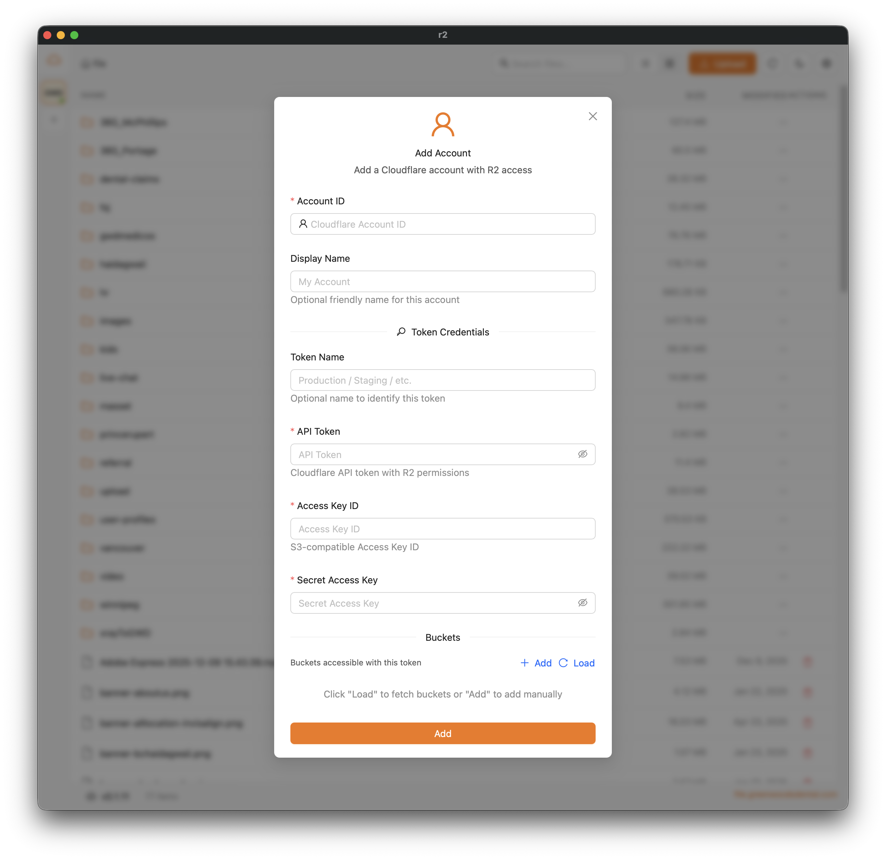

[English](./README.md) | [简体中文](./README.zh-CN.md) | [हिन्दी](./README.hi.md) | [Español](./README.es.md) | **日本語**

# Cloudflare R2 Client — macOS・Windows・Linux 向けの無料オープンソース S3 デスクトップ GUI

**Cloudflare R2 Client** は、Mac、Windows PC、Linux マシンから **Cloudflare R2**、**AWS S3**、**MinIO**、**RustFS** のオブジェクトストレージを管理できる、無料・オープンソースのデスクトップアプリ（GUI）です。バケットの閲覧、再開可能なマルチパート転送によるファイルのアップロード／ダウンロード、画像・動画・PDF・コードのプレビュー、複数アカウントとトークンの管理、プロバイダー間のファイル移動を、**Tauri**、**Next.js**、**React** で構築された高速なネイティブアプリひとつで行えます。

> 無料の Cloudflare R2 GUI、Mac 用 S3 クライアント、MinIO のデスクトップブラウザー、RustFS のファイルマネージャーをお探しですか？これがまさに求めていたオールインワンの S3 互換ストレージクライアントです。

**キーワード:** Cloudflare R2 デスクトップクライアント、R2 GUI、S3 クライアント macOS、S3 GUI Windows、MinIO ブラウザー、RustFS GUI、S3 ファイルマネージャー、オブジェクトストレージ デスクトップアプリ、Tauri R2 アップローダー

## 機能

- **マルチプロバイダー対応** - R2、AWS S3、MinIO、RustFS（パススタイル強制）
- **マルチアカウント対応** - 複数プロバイダーにまたがる複数アカウントを管理
- **アカウントごとに複数トークン（R2）** - 各アカウントに、異なるバケットへのアクセス権を持つ複数の API トークンを登録可能
- S3 互換バケット内のファイルを閲覧・管理
- 再開可能なマルチパートアップロードでファイルやフォルダーをアップロード
- **ファイルプレビュー** - アプリ内で直接ファイルをプレビュー:
  - **画像**: jpg, jpeg, png, gif, webp, svg, bmp, ico
  - **動画**: mp4, webm, ogg, mov, m4v
  - **PDF**: ページ移動に対応したフル機能の PDF ビューアー
  - **テキスト／コード**: Monaco Editor によるシンタックスハイライト付きビューアー。対応形式:
    - コード: js, ts, jsx, tsx, css, scss, less, html, vue, svelte
    - 設定: json, yaml, yml, toml, xml, ini, env
    - ドキュメント: txt, md, markdown, rst, log
    - スクリプト: sh, bash, zsh, fish, ps1, bat, cmd
    - データ: csv, sql
- **一括操作** - ファイルやフォルダーを複数選択して:
  - **一括ダウンロード** - 進捗表示と一時停止／再開に対応した複数ファイルのダウンロード
  - **一括移動** - フォルダーツリーから移動先を選んでファイルを移動
  - **一括削除** - 確認ダイアログと進捗表示付きで複数ファイルを削除
  - **フォルダー内ファイルの一括リネーム** - 確認ダイアログと進捗表示付きでフォルダー内のファイル名を変更
- **アカウント間転送** - 異なるアカウント／プロバイダー間の高速ファイル転送:
  - R2、AWS S3、MinIO、RustFS の間でファイルを転送
  - 可能な場合はサーバーサイドコピー（同一プロバイダー）
  - プロバイダーをまたぐ移動は一時ファイルを使わないストリーミング転送
  - 大きなファイルは並列マルチパートアップロード（4 パート同時）
  - 最大 5 件の同時転送
  - 転送速度付きのリアルタイム進捗表示
  - 個別または全転送の一時停止／再開／キャンセル
  - バックグラウンド処理 - モーダルを閉じてもキューは継続
  - 各転送の完了後、自動的にキューを続行
- **ローカルドライブとしてマウント** - 任意のバケットをローカルフォルダーにマウントし、Finder／エクスプローラーで操作:
  - デフォルトで読み書き可能 — フォルダー内で直接ファイルを保存・リネーム・削除でき、マウントごとの切り替えで読み取り専用にも可能
  - アプリ自身が提供する NFS マウント — macFUSE、WinFsp、カーネル拡張は不要
  - 設定 → マウント ですべてのアクティブなマウントを管理
  - すべてのプロバイダー（R2、AWS S3、MinIO、RustFS）で動作
  - macOS は追加ソフトなしで即座にマウント、Linux は nfs-utils が必要、Windows 対応は予定中
  - アプリ終了時にすべてのマウントを自動で解除
- 動画サムネイルの生成（ffmpeg はアプリに同梱されているため、別途インストール不要）
- 署名付き URL または公開 URL をクリップボードにコピー（プロバイダーに応じたリンク生成）
- ダークモード対応
- 自動アップデート
- ワンクリックの「問題を報告」: アプリのバージョン、OS、直近 5 分間のアプリエラーが入力済みの GitHub issue 下書きを開きます（アクセスキーやシークレットは伏せられます。内容を確認でき、Submit を押すまで何も送信されません）

## インストール

### Homebrew（macOS）

```bash
brew install dickwu/tap/r2
```

### ダウンロード

[Releases ページ](https://github.com/dickwu/r2/releases/latest) から、お使いのプラットフォーム向けの最新リリースをダウンロードしてください:

- macOS: .dmg（Apple Silicon および Intel）
- Windows: .msi または .exe インストーラー
- Linux: .deb、.rpm、または .AppImage

## スクリーンショット



### 必須

- [Node.js](https://nodejs.org/)（v18 以上）
- [Bun](https://bun.sh/) - パッケージマネージャー
- [Rust](https://www.rust-lang.org/tools/install) - Tauri バックエンド用

### 動画サムネイル

追加のセットアップは不要です。アプリには動画サムネイル生成用の ffmpeg が同梱されているため、システムに ffmpeg をインストールする必要はありません。

## macOS でのインストール

macOS では、アプリの実行を手動で許可する必要があります:

1. システム設定 → プライバシーとセキュリティ を開きます
2. ブロックされたアプリのメッセージの横にある「このまま開く」をクリックします

プライバシーとセキュリティにアプリが表示されない場合は、次を実行してください:

```bash
sudo xattr -d com.apple.quarantine /Applications/r2.app/
```

実行できないというエラーが出る場合は、次を試してください:

```bash
rm -rf ~/Library/Application\ Support/com.lifefarmer.r2/
rm -rf ~/Library/Caches/com.lifefarmer.r2/
rm -rf ~/Library/Saved\ Application\ State/com.lifefarmer.r2.savedState/
```

## 開発

```bash
# 依存関係をインストール
bun install

# 開発サーバーを起動
bun run tauri dev
```

### tauri-connector によるデバッグ

AI 支援によるデバッグとテストのために [tauri-connector](https://github.com/dickwu/tauri-connector) が組み込まれています。CLI または MCP サーバー経由で、DOM の検査、要素の操作、スクリーンショット、コンソールログへのアクセスが可能です。

```bash
# コネクターを有効にして起動（固定ポート: WS 9568、MCP 9567 — .mcp.json を参照）
bun run tauri:dev

# CLI コマンド（アプリ起動後）
tauri-connector snapshot -i          # 要素参照付きの AI 向け DOM スナップショット
tauri-connector click @e5            # 参照で要素をクリック
tauri-connector fill @e18 "query"    # 検索ボックスに入力
tauri-connector screenshot /tmp/r2.png  # スクリーンショットを撮影
tauri-connector logs -n 20           # コンソールログを表示
```

CLI のインストール: `cargo install connector-cli`

## ビルド

```bash
# 本番用にビルド
bun run tauri build
```

### Windows 向けクロスコンパイル（macOS／Linux から）

macOS や Linux から Windows バイナリをビルドするには、追加のツールが必要です:

```bash
# 必要な依存関係をインストール
# macOS
brew install cmake ninja llvm nsis

# Ubuntu/Debian
sudo apt-get install cmake ninja-build llvm nsis

# cargo-xwin をインストール
cargo install --locked cargo-xwin

# Windows ツールチェーンをセットアップ
cargo xwin setup

# Windows ターゲットを追加
rustup target add x86_64-pc-windows-msvc

# Windows 向けにビルド
bun run tauri build --runner cargo-xwin --target x86_64-pc-windows-msvc
```

注意: クロスコンパイルは実験的な機能です。本番ビルドには GitHub Actions または Windows VM の利用を検討してください。

## 設定

### アカウントの追加

1. 初回起動時に「Add Account」（アカウント追加）ダイアログが自動で開きます
2. クリック可能なタグでプロバイダー（R2、AWS、MinIO、RustFS）を選択します
3. プロバイダーごとの認証情報を入力します:
   - R2:
     - Account ID（必須）- Cloudflare のアカウント ID（ダッシュボードの URL から確認）
     - Token Name（任意）
     - API Token - R2 の読み書きトークン
     - Access Key ID / Secret Access Key
   - AWS S3:
     - Access Key ID / Secret Access Key
     - Region（必須）
     - Endpoint（任意。カスタムのスキーム + ホスト）
     - Force Path Style（任意）
   - MinIO:
     - Access Key ID / Secret Access Key
     - Endpoint（スキーム + ホスト／ポート）
     - Force Path Style（任意）
   - RustFS:
     - Access Key ID / Secret Access Key
     - Endpoint（スキーム + ホスト／ポート）
     - Force Path Style は常に有効（変更不可）
4. 「Load」をクリックして利用可能なバケットを取得するか、バケット名を手動で追加します
5. バケットごとに公開ドメインを設定します（任意、R2／AWS のみ）

エンドポイント／ドメインのヒント

- エンドポイントとドメインの入力欄には完全な URL（スキーム + ホスト）を入力でき、自動的に正規化されます。
- R2／AWS の公開ドメインでは、http／https を明示的に選択できます。

### 複数アカウントの管理

- サイドバー - 設定済みのすべてのアカウントを、トークン数／バケット数とともに表示
- アカウントをクリック - そのアカウントのすべてのトークンとバケットを表示するドロワーを開く
- バケットをクリック - そのバケットに切り替え
- コンテキストメニュー - アカウント／トークンの編集・削除
- サイドバーの折りたたみ - 折りたたみアイコンをクリックしてアイコンのみの表示に縮小

### 別アカウントへの同期（移動／コピー）

一括移動のワークフローを使って、アカウント／プロバイダー間でファイルを同期します:

1. 移動元と移動先の両方のアカウントを追加します。
2. サイドバーで移動元のバケットに切り替えます。
3. ファイル／フォルダーを選択 -> 一括移動。
4. 移動先のアカウント + バケットと、任意で移動先フォルダーを選択します。
5. 「Delete original」（元ファイルを削除）を切り替えます:
   - オン = 移動（転送後に移動元のファイルを削除）
   - オフ = コピー（移動元のファイルを保持）
6. 転送を開始し、移動モーダル／ステータスバーで進捗を確認します。

転送はキューに入り（最大 5 件同時）、同一プロバイダー間の転送ではサーバーサイドコピーが優先されます。

### バケットをローカルドライブとしてマウント

任意のバケットをローカルフォルダーにマウントし、通常のディスクのように使えます:

1. サイドバーでバケットのメニュー（⋯）を開き → Mount as local drive（ローカルドライブとしてマウント）。
2. ローカルフォルダーを選択します（デフォルトは `~/CloudMounts/<bucket>`）。マウントはデフォルトで書き込み可能です。読み取り専用にするには「Allow changes」（変更を許可）をオフにします。
3. Finder／ファイルマネージャーでフォルダーを使います: ファイルを開く、コピー、保存、リネーム、削除。変更は書き込み完了の少し後にバックグラウンドでバケットへアップロードされます。
4. アクティブなマウントは 設定 → マウント（表示、アンマウント）またはバケットのメニューから管理します。アプリ終了時にすべてのマウントは解除されます。

仕組み: アプリは `127.0.0.1` 上で小さな NFSv3 サーバーを動かし、OS 標準の NFS クライアントでマウントします。macFUSE、WinFsp、カーネル拡張は不要です。マウント内でのファイルのリネームや移動は、アプリ自身の移動機能と同様にバケット側（サーバーサイド）で行われます（再アップロードなし）。注意: 一般的なローカルマウントと同じく、バケットをマウントしている間は、マシン上の他のアプリもそのファイルを読み取れます（書き込み可能なマウントでは変更も可能です）。サーバーがネットワークからアクセス可能になることはありません。

書き込み可能なマウントについて知っておくべきこと:

- アップロードはバックグラウンドで完了します — 完了するまでアプリを起動したままにしてください。アンマウント時は保留中のアップロードを待ちます。アップロード中に終了した場合、未送信のファイルはアプリのキャッシュフォルダーに残り、その場所がログに記録されます。
- フォルダー内での削除や上書きは、実際にバケットに対して行われる操作です。
- macOS は通常どおり `.DS_Store` や `._*` の補助ファイルをフォルダーに書き込むため、それらもバケットに保存されます。
- マウントした 2 つのバケット間でファイルを移動すると、データはお使いのマシンを経由します（NFSv3 の制約）。バケット間の大容量転送には、サーバーサイドでコピーするアプリの一括移動のほうがはるかに高速です。

プラットフォーム別の注意:

- macOS - 即座にマウント。追加ソフトも sudo も不要です。
- Linux - `nfs-utils`（または `nfs-common`）が必要です。ディストリビューションで NFS マウントに root 権限が必要な場合は、ターミナルで一度だけ実行すべき正確な `sudo mount` コマンドがアプリに表示されます。
- Windows - 現時点では未対応。今後のリリースで対応予定です。

### API 認証情報の取得

Cloudflare R2

1. [Cloudflare Dashboard](https://dash.cloudflare.com/) にアクセスします
2. R2 → Overview → Manage R2 API Tokens に移動します
3. 適切な権限を持つトークンを作成します
4. Access Key ID と Secret Access Key を控えておきます（表示されるのは一度だけです）

AWS S3

- S3 の権限を持つ IAM ユーザーを作成し、アクセスキーを生成します。
- バケットの Region を控えておきます。

MinIO / RustFS

- デプロイメントのアクセスキー／シークレットキーを使用します。
- エンドポイントのホスト／ポートとスキーム（http／https）を設定します。

## データの保存場所

アカウント設定はローカルの SQLite データベースに保存されます:

- macOS: `~/Library/Application Support/r2/uploads-turso.db`
- Windows: `%APPDATA%\r2\uploads-turso.db`
- Linux: `~/.local/share/r2/uploads-turso.db`

## 技術スタック

- **フロントエンド**: Next.js、React、Ant Design、Zustand
- **バックエンド**: Tauri（Rust）
- **ストレージ**: Cloudflare R2、AWS S3、MinIO、RustFS（S3 互換）
- **データベース**: SQLite（Turso 経由 — Rust 製の SQLite 互換データベース）
- **状態管理**: TanStack Query、Zustand

## IDE のセットアップ

- [VS Code](https://code.visualstudio.com/) + [Tauri](https://marketplace.visualstudio.com/items?itemName=tauri-apps.tauri-vscode) + [rust-analyzer](https://marketplace.visualstudio.com/items?itemName=rust-lang.rust-analyzer)
