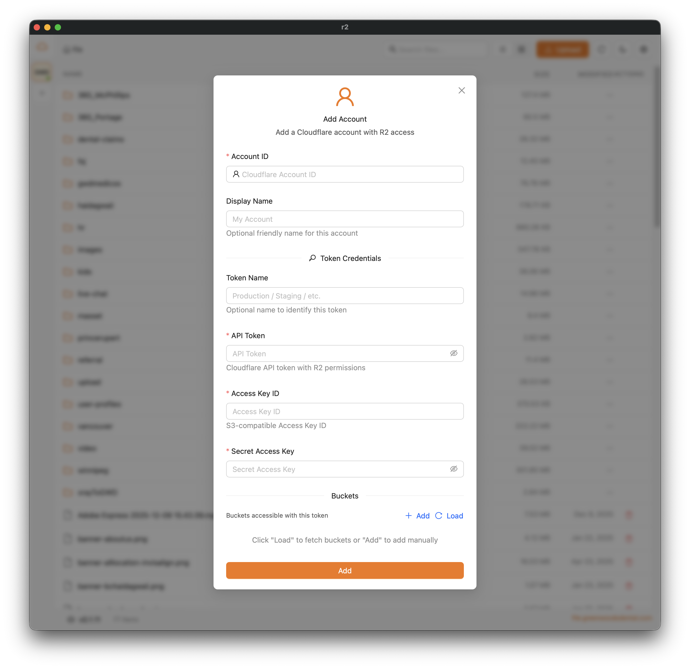

[English](./README.md) | **简体中文** | [हिन्दी](./README.hi.md) | [Español](./README.es.md) | [日本語](./README.ja.md)

# Cloudflare R2 Client — 免费开源的 S3 桌面图形客户端，支持 macOS、Windows 和 Linux

**Cloudflare R2 Client** 是一款免费、开源的桌面应用（GUI），可在 Mac、Windows PC 或 Linux 电脑上管理 **Cloudflare R2**、**AWS S3**、**MinIO** 和 **RustFS** 对象存储。你可以浏览存储桶，通过可断点续传的分片传输上传和下载文件，预览图片、视频、PDF 和代码，管理多个账户和令牌，并在不同存储服务之间迁移文件——这一切都在一个基于 **Tauri**、**Next.js** 和 **React** 构建的快速原生应用中完成。

> 正在寻找免费的 Cloudflare R2 图形界面、Mac 上的 S3 客户端、MinIO 桌面浏览器或 RustFS 文件管理器？这就是你要找的一站式 S3 兼容存储客户端。

**关键词：** Cloudflare R2 桌面客户端、R2 GUI、S3 客户端 macOS、S3 GUI Windows、MinIO 浏览器、RustFS GUI、S3 文件管理器、对象存储桌面应用、Tauri R2 上传工具。

## 功能特性

- **多存储服务支持** - R2、AWS S3、MinIO 和 RustFS（强制使用路径样式）
- **多账户支持** - 跨不同存储服务管理多个账户
- **每个账户多个令牌（R2）** - 每个账户可拥有多个 API 令牌，分别对应不同的存储桶访问权限
- 浏览和管理 S3 兼容存储桶中的文件
- 通过可断点续传的分片上传来上传文件和文件夹
- **文件预览** - 直接在应用内预览文件：
  - **图片**：jpg、jpeg、png、gif、webp、svg、bmp、ico
  - **视频**：mp4、webm、ogg、mov、m4v
  - **PDF**：完整的 PDF 查看器，支持翻页导航
  - **文本/代码**：基于 Monaco Editor 的语法高亮查看器，支持：
    - 代码：js、ts、jsx、tsx、css、scss、less、html、vue、svelte
    - 配置：json、yaml、yml、toml、xml、ini、env
    - 文档：txt、md、markdown、rst、log
    - 脚本：sh、bash、zsh、fish、ps1、bat、cmd
    - 数据：csv、sql
- **批量操作** - 多选文件和文件夹，进行：
  - **批量下载** - 下载多个文件，带进度跟踪，支持暂停/继续
  - **批量移动** - 通过文件夹树选择器将文件移动到其他文件夹
  - **批量删除** - 删除多个文件，带确认提示和进度指示
  - **文件夹内批量重命名** - 重命名文件夹中的文件，带确认提示和进度指示
- **跨账户传输** - 在不同账户/存储服务之间高性能传输文件：
  - 在 R2、AWS S3、MinIO 和 RustFS 之间传输文件
  - 尽可能使用服务端复制（同一存储服务内）
  - 跨存储服务迁移时采用流式传输，不产生临时文件
  - 大文件并行分片上传（4 个分片并发）
  - 最多 5 个传输任务并发
  - 实时进度跟踪并显示速度
  - 可暂停/继续/取消单个或全部传输
  - 后台处理——即使关闭弹窗，队列仍会继续
  - 每个传输完成后自动继续处理队列
- **挂载为本地磁盘** - 将任意存储桶挂载到本地文件夹，在访达（Finder）/ 资源管理器中直接使用：
  - 默认可读写——直接在文件夹中保存、重命名和删除文件；每个挂载都可单独切换为只读
  - 由应用自身提供 NFS 挂载服务——无需 macFUSE、WinFsp 或内核扩展
  - 在“设置 → 挂载”中管理所有活动挂载
  - 适用于所有存储服务（R2、AWS S3、MinIO、RustFS）
  - macOS 无需额外软件即可立即挂载；Linux 需要 nfs-utils；Windows 支持正在规划中
  - 应用退出时会自动移除所有挂载
- 视频缩略图生成（应用已内置 ffmpeg，无需单独安装）
- 将签名 URL 或公开 URL 复制到剪贴板（根据存储服务生成相应链接）
- 支持深色模式
- 自动更新
- 一键“报告问题”：打开预填好的 GitHub issue 草稿，包含应用版本、操作系统以及最近 5 分钟的应用错误（访问密钥和机密信息会被隐去；你可以先检查内容，只有点击 Submit 后才会提交）

## 安装

### Homebrew（macOS）

```bash
brew install dickwu/tap/r2
```

### 下载

从 [Releases 页面](https://github.com/dickwu/r2/releases/latest) 下载适用于你平台的最新版本：

- macOS：.dmg（Apple Silicon 和 Intel）
- Windows：.msi 或 .exe 安装程序
- Linux：.deb、.rpm 或 .AppImage

## 截图



### 必需

- [Node.js](https://nodejs.org/)（v18+）
- [Bun](https://bun.sh/) - 包管理器
- [Rust](https://www.rust-lang.org/tools/install) - 用于 Tauri 后端

### 视频缩略图

无需额外配置：应用自带 ffmpeg 用于生成视频缩略图，因此你不需要在系统中安装 ffmpeg。

## macOS 安装说明

在 macOS 上，你需要手动允许应用运行：

1. 打开“系统设置”→“隐私与安全性”
2. 在应用被阻止的提示旁点击“仍要打开”

如果该应用没有出现在“隐私与安全性”设置中，请运行：

```bash
sudo xattr -d com.apple.quarantine /Applications/r2.app/
```

如果遇到无法运行的错误，请尝试运行：

```bash
rm -rf ~/Library/Application\ Support/com.lifefarmer.r2/
rm -rf ~/Library/Caches/com.lifefarmer.r2/
rm -rf ~/Library/Saved\ Application\ State/com.lifefarmer.r2.savedState/
```

## 开发

```bash
# 安装依赖
bun install

# 启动开发服务器
bun run tauri dev
```

### 使用 tauri-connector 调试

项目集成了 [tauri-connector](https://github.com/dickwu/tauri-connector)，用于 AI 辅助的调试和测试。它可以通过 CLI 或 MCP 服务器提供 DOM 检查、元素交互、截图和控制台日志访问。

```bash
# 启用 connector 启动（固定端口：WS 9568，MCP 9567 — 见 .mcp.json）
bun run tauri:dev

# CLI 命令（应用运行后）
tauri-connector snapshot -i          # 带元素引用的 AI DOM 快照
tauri-connector click @e5            # 按引用点击元素
tauri-connector fill @e18 "query"    # 填写搜索框
tauri-connector screenshot /tmp/r2.png  # 截图
tauri-connector logs -n 20           # 查看控制台日志
```

安装 CLI：`cargo install connector-cli`

## 构建

```bash
# 构建生产版本
bun run tauri build
```

### 交叉编译 Windows 版本（在 macOS/Linux 上）

要在 macOS 或 Linux 上构建 Windows 二进制文件，需要额外的工具：

```bash
# 安装所需依赖
# macOS
brew install cmake ninja llvm nsis

# Ubuntu/Debian
sudo apt-get install cmake ninja-build llvm nsis

# 安装 cargo-xwin
cargo install --locked cargo-xwin

# 配置 Windows 工具链
cargo xwin setup

# 添加 Windows 目标
rustup target add x86_64-pc-windows-msvc

# 构建 Windows 版本
bun run tauri build --runner cargo-xwin --target x86_64-pc-windows-msvc
```

注意：交叉编译仍属实验性功能。生产构建建议使用 GitHub Actions 或 Windows 虚拟机。

## 配置

### 添加账户

1. 首次启动时，“Add Account”（添加账户）对话框会自动打开
2. 通过可点击的标签选择存储服务（R2、AWS、MinIO、RustFS）
3. 输入对应服务的凭据：
   - R2：
     - Account ID（必填）- Cloudflare 账户 ID（可从控制台 URL 获取）
     - Token Name（可选）
     - API Token - R2 读写令牌
     - Access Key ID / Secret Access Key
   - AWS S3：
     - Access Key ID / Secret Access Key
     - Region（必填）
     - Endpoint（可选，自定义协议 + 主机）
     - Force Path Style（可选）
   - MinIO：
     - Access Key ID / Secret Access Key
     - Endpoint（协议 + 主机/端口）
     - Force Path Style（可选）
   - RustFS：
     - Access Key ID / Secret Access Key
     - Endpoint（协议 + 主机/端口）
     - Force Path Style 始终启用（不可配置）
4. 点击“Load”获取可用的存储桶，或手动添加存储桶名称
5. 为每个存储桶配置公开域名（可选，仅限 R2/AWS）

Endpoint/域名提示

- Endpoint 和域名输入框接受完整 URL（协议 + 主机），并会自动规范化。
- 对于 R2/AWS 公开域名，可以显式选择 http/https。

### 管理多个账户

- 侧边栏 - 显示所有已配置的账户及其令牌/存储桶数量
- 点击账户 - 打开抽屉，显示该账户的所有令牌和存储桶
- 点击存储桶 - 切换到该存储桶
- 右键菜单 - 编辑或删除账户/令牌
- 折叠侧边栏 - 点击折叠图标，缩小为仅显示图标的视图

### 同步到其他账户（移动/复制）

使用批量移动流程在账户/存储服务之间同步文件：

1. 添加源账户和目标账户。
2. 在侧边栏中切换到源存储桶。
3. 选择文件/文件夹 -> 批量移动。
4. 选择目标账户 + 存储桶，以及可选的目标文件夹。
5. 切换“Delete original”（删除原文件）：
   - 开启 = 移动（传输完成后删除源文件）
   - 关闭 = 复制（保留源文件）
6. 开始传输，并在移动弹窗/状态栏中跟踪进度。

传输任务会排队（最多 5 个并发），同一存储服务内的传输会优先使用服务端复制。

### 将存储桶挂载为本地磁盘

将任意存储桶挂载到本地文件夹，像普通磁盘一样使用：

1. 在侧边栏打开存储桶菜单（⋯）→ Mount as local drive（挂载为本地磁盘）。
2. 选择一个本地文件夹（默认为 `~/CloudMounts/<bucket>`）。挂载默认可写——关闭“Allow changes”（允许更改）即可设为只读挂载。
3. 在访达 / 文件管理器中使用该文件夹：打开、复制、保存、重命名和删除文件。写入完成后不久，更改会在后台上传到存储桶。
4. 在“设置 → 挂载”中管理活动挂载（显示位置、卸载），也可通过存储桶菜单管理。应用退出时会移除所有挂载。

工作原理：应用会在 `127.0.0.1` 上运行一个小型 NFSv3 服务器，并通过操作系统内置的 NFS 客户端挂载——无需 macFUSE、WinFsp 或内核扩展。在挂载中重命名或移动文件会直接在存储桶的服务端完成（无需重新上传），与应用自带的移动功能相同。注意：和任何本地挂载一样，存储桶挂载期间，你电脑上的其他应用可以读取其中的文件——对于可写挂载，还可以修改；该服务器绝不会对网络开放。

可写挂载须知：

- 上传在后台完成——请保持应用运行直到上传结束。卸载时会等待待上传的文件；如果在上传过程中退出，未上传的文件会保留在应用的缓存文件夹中，并在日志中记录其位置。
- 在文件夹中删除和覆盖文件，都是对存储桶的真实操作。
- macOS 会照常在文件夹中写入 `.DS_Store` 和 `._*` 辅助文件，因此它们也会出现在存储桶中。
- 在两个已挂载的存储桶之间移动文件时，数据会经过你的电脑中转（NFSv3 的限制）——跨存储桶的大量传输，使用应用的批量移动会快得多，因为它采用服务端复制。

平台说明：

- macOS - 立即挂载；无需额外软件，也无需 sudo。
- Linux - 需要 `nfs-utils`（或 `nfs-common`）。如果你的发行版需要 root 权限才能进行 NFS 挂载，应用会显示需要在终端中运行一次的确切 `sudo mount` 命令。
- Windows - 暂不支持；计划在未来版本中提供。

### 获取 API 凭据

Cloudflare R2

1. 前往 [Cloudflare Dashboard](https://dash.cloudflare.com/)
2. 进入 R2 → Overview → Manage R2 API Tokens
3. 创建一个具有相应权限的令牌
4. 记下 Access Key ID 和 Secret Access Key（仅显示一次）

AWS S3

- 创建一个具有 S3 权限的 IAM 用户并生成访问密钥。
- 记下存储桶所在的 Region。

MinIO / RustFS

- 使用你部署中的访问密钥/私密密钥。
- 设置 Endpoint 的主机/端口和协议（http/https）。

## 数据存储

账户配置保存在本地的 SQLite 数据库中：

- macOS：`~/Library/Application Support/r2/uploads-turso.db`
- Windows：`%APPDATA%\r2\uploads-turso.db`
- Linux：`~/.local/share/r2/uploads-turso.db`

## 技术栈

- **前端**：Next.js、React、Ant Design、Zustand
- **后端**：Tauri（Rust）
- **存储**：Cloudflare R2、AWS S3、MinIO、RustFS（S3 兼容）
- **数据库**：SQLite（通过 Turso——基于 Rust 的 SQLite 兼容数据库）
- **状态管理**：TanStack Query、Zustand

## IDE 配置

- [VS Code](https://code.visualstudio.com/) + [Tauri](https://marketplace.visualstudio.com/items?itemName=tauri-apps.tauri-vscode) + [rust-analyzer](https://marketplace.visualstudio.com/items?itemName=rust-lang.rust-analyzer)
